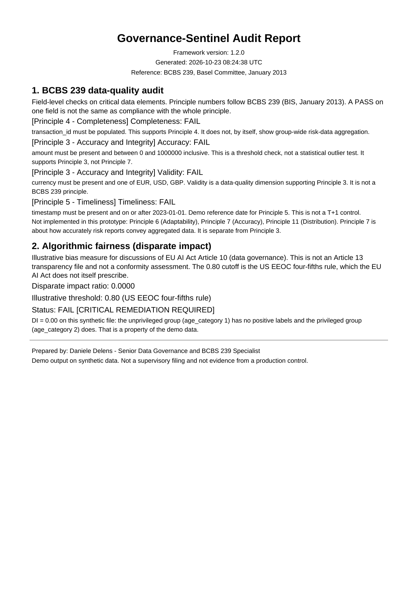

# Governance-Sentinel

[](https://github.com/delens/Governance-Sentinel/actions/workflows/ci.yml)

A Compliance-as-Code prototype for a hiring-manager review: four field-level data-quality checks mapped to BCBS 239, a disparate-impact ratio from IBM AIF360, and a one-page PDF.

**Notice.** Personal research sandbox. The data is synthetic. This project is not affiliated with any employer, client, or production system. The full notice is at the end of this file.

## Run it

Requires **Python 3.12**. The pins in `requirements.txt` include NumPy 2.5, SciPy 1.18, and scikit-learn 1.9, which are published for 3.12.

```bash
python -m pip install -r requirements.txt
python main.py
```

| Output | What it is |
| --- | --- |
| `Audit_Report.pdf` | Audit report. The copy in the repo is a sample from the run below. A later run overwrites it. |
| `governance_sentinel.log` | UTC log, appended on each run. Git ignores it. |
| `raw_financial_data.csv` | Five synthetic rows, rewritten in mock mode. |

```bash
python main.py --mode real --csv raw_financial_data.csv
python main.py --log-level DEBUG
```

`--mode real` reads the CSV and checks that the expected columns are present. There is no database or API loader. `--log-level` sets the root logger (default `INFO`). If the flag is omitted, the `LOG_LEVEL` environment variable is used.

## Sample console output

```text
2026-10-23 08:24:37 UTC | INFO     | __main__ | Governance-Sentinel 1.2.0 starting
2026-10-23 08:24:37 UTC | INFO     | __main__ | STEP 1/4 - Loading data (mode=mock)
2026-10-23 08:24:37 UTC | INFO     | data_loader | Mock mode: generating a synthetic dataset with intentional anomalies.
2026-10-23 08:24:37 UTC | INFO     | data_loader | Mock dataset written to raw_financial_data.csv (5 rows).
2026-10-23 08:24:37 UTC | INFO     | __main__ | Dataset loaded: 5 rows, 7 columns
2026-10-23 08:24:37 UTC | INFO     | __main__ | STEP 2/4 - BCBS 239 data-quality audit
2026-10-23 08:24:37 UTC | INFO     | validators | BCBS 239 audit completed: {'Completeness': False, 'Accuracy': False, 'Validity': False, 'Timeliness': False}
2026-10-23 08:24:37 UTC | INFO     | __main__ | STEP 3/4 - Disparate-impact audit
2026-10-23 08:24:38 UTC | INFO     | bias_audit | Disparate impact (unprivileged / privileged): 0.0000
2026-10-23 08:24:38 UTC | INFO     | __main__ | STEP 4/4 - Writing PDF audit report
2026-10-23 08:24:38 UTC | INFO     | reporter | PDF report written to Audit_Report.pdf.
2026-10-23 08:24:38 UTC | INFO     | __main__ | Pipeline completed successfully.
2026-10-23 08:24:38 UTC | INFO     | __main__ | Files: Audit_Report.pdf | governance_sentinel.log
```

Every data-quality check fails on this file, and the disparate-impact ratio is 0.0000. The rows were built that way.

## Report preview



`Audit_Report.pdf` in the repository root is that sample.

## BCBS 239 mapping

The principle numbers follow the Basel Committee on Banking Supervision, *Principles for effective risk data aggregation and risk reporting* (BCBS 239), January 2013: <https://www.bis.org/publ/bcbs239.pdf>.

| Check | BCBS 239 | What this prototype measures |
| --- | --- | --- |
| Completeness | Principle 4, Completeness (paragraphs 41-43) | `transaction_id` is populated. Principle 4 is about capturing material risk data across the group. This check is only the identifier. |
| Accuracy | Principle 3, Accuracy and Integrity (paragraphs 36-40) | `amount` is populated and between 0 and 1000000 inclusive. This is a fixed threshold. |
| Validity | Supports Principle 3. Validity is a data-quality dimension, and BCBS 239 does not list it as a principle. | `currency` is populated and one of EUR, USD, GBP. Paragraph 37 expects concepts to be defined consistently. A short whitelist is the demo version of that idea. |
| Timeliness | Principle 5, Timeliness (paragraphs 44-47) | `timestamp` parses and falls on or after 2023-01-01. Principle 5 leaves the deadline to the bank. `2023-01-01` is the reference date used in this demo. |

The PDF also names three principles this repository does not implement:

- Principle 6, Adaptability (paragraphs 48-50): ad hoc aggregation.
- Principle 7, Accuracy (paragraphs 52-56): risk reports convey aggregated data accurately. This is a reporting principle, separate from Principle 3.
- Principle 11, Distribution (paragraphs 72-73): the right people receive the report, and confidentiality holds.

Each check rejects nulls in the field it owns. A null amount fails Accuracy. A missing required column stops the audit before the checks run. An empty frame fails every check. The audit copies the frame and leaves the caller's data unchanged.

### Rows in the synthetic file

| transaction_id | Designed result |
| --- | --- |
| 101 | Passes all four checks |
| 102 | Accuracy fails (amount -50) |
| null | Completeness fails, and Timeliness fails (2022-01-01) |
| 104 | Validity fails (currency XYZ) |
| 105 | Accuracy fails (amount 9999999) |

Run on the whole file, all four checks fail.

## Disparate impact

AIF360's `BinaryLabelDatasetMetric.disparate_impact` is:

$$DI = \frac{P(\text{loan approved} \mid \text{unprivileged})}{P(\text{loan approved} \mid \text{privileged})}$$

In this file, `age_category` 1 is the unprivileged group (the demo label is Senior) and `age_category` 2 is the privileged group (the demo label is Junior). Those labels belong to the synthetic file. On that file the unprivileged group has no approvals and the privileged group does, so the ratio is 0.00.

The PDF treats a ratio below 0.80 as a fail. 0.80 is the US EEOC four-fifths rule, used here as a demo cutoff. The EU AI Act does not define that cutoff. The metric is an illustration next to Article 10 (data and data governance). It is not an Article 13 transparency pack, and it is not a conformity assessment.

Rows missing `age_category` or `loan_approved` are dropped from the metric. A null `transaction_id` does not drop the row.

TensorFlow is not installed or imported. AIF360's TensorFlow extra is only for adversarial debiasing, which this prototype does not run. Import notices for other optional AIF360 extras are filtered out of the log. The root log level stays at the level you set.

## Roadmap

There is no GitHub Project board on this repository. This list is the roadmap.

In the repository now: the four checks, the disparate-impact ratio, the PDF, and a CSV reader.

Left out on purpose: a dashboard, data lineage, a rules catalog, automated fixes, and loaders other than CSV.

## Checks

```bash
python -m pip install -r requirements-dev.txt
ruff check .
ruff format --check .
mypy
pytest
```

GitHub Actions runs those commands on Python 3.12 (`.github/workflows/ci.yml`).

## Changelog

### [1.2.0] — 2026-10-23

#### Fixed

- PDF generation. Core Helvetica cannot encode check marks, crosses, an em dash, or box-drawing characters, so `python main.py` exited at the PDF step. The report is ASCII. The fpdf2 `ln` argument and the Arial font alias are gone.
- BCBS 239 numbers in the validators, the PDF, and this file. Completeness supports Principle 4, the amount check supports Principle 3, and timeliness supports Principle 5. Validity is described as a data-quality dimension under Principle 3.
- The report clock is timezone-aware UTC.
- `FRAMEWORK_VERSION` is `1.2.0`, the same version as this section.
- The root log level is `--log-level` or `LOG_LEVEL`, default INFO.
- `--mode real` works from the command line.
- Comments, log lines, and CLI text are in English.

#### Added

- pytest coverage for each designed PASS/FAIL on the synthetic rows, plus an end-to-end run that writes a PDF.
- GitHub Actions workflow for ruff, mypy, and pytest, and the CI badge above.
- MIT `LICENSE`.
- `.gitignore` for caches, logs, and generated PDFs, with `Audit_Report.pdf` kept as the sample.
- Exact dependency pins in `requirements.txt` and `requirements-dev.txt`.
- `docs/audit_report_preview.png`.

### [1.1.0] — 2026-05-24

#### Fixed

- `validators.py` copies the frame before the checks.
- Each check rejects nulls in the field it assesses. A missing required column aborts the audit. (An earlier note said a separate null sweep covered every critical element before the domain checks. The null rule lives inside each check.)
- `main.py` logs the traceback on failure.
- The PDF gained a timestamp and a version line. The clock was still a naive local time labelled UTC until 1.2.0, and the version line stayed at 1.0.0 until 1.2.0.

#### Added

- `data_loader.py` accepts `mode='mock'` or `mode='real'` and checks `REQUIRED_COLUMNS` on a CSV. The command-line flag was added in 1.2.0. There is no database or API loader.
- The PDF names a principle beside each check. Those numbers were corrected in 1.2.0.
- The PDF calls out a disparate-impact ratio of 0.00 on the synthetic file.
- Logging goes to the console and to `governance_sentinel.log`.
- `requirements.txt` was added here. The versions were ranges. Exact pins are in 1.2.0.

### [1.0.0] — 2026-05-01

#### Added

- Data-quality checks for completeness, accuracy, validity, and timeliness, plus a synthetic file with known failures. The release note originally cited BCBS 239 Principles 3, 4, 6, and 11. That citation was wrong; see 1.2.0.
- Disparate-impact audit through IBM AIF360.
- PDF report through fpdf2.

## License

MIT. See [LICENSE](LICENSE).

## Full notice

**This repository is a personal sandbox environment, developed entirely in my own time and on my own initiative.**

The project was created to explore open-source tooling — Python, draw.io, Mermaid, AI libraries — applied to regulatory scenarios inspired by publicly available frameworks such as BCBS 239 and the EU AI Act. Its purpose is strictly educational and experimental.

> **All data used in this project is entirely synthetic and artificially generated.** It does not contain, reproduce, or derive from any real data, systems, internal processes, documentation, or intellectual property belonging to any organisation. Any resemblance to real business scenarios is purely coincidental and a natural consequence of working with publicly documented regulatory frameworks.

This project is not connected in any way to any professional activity, employer (past or present), client, or production system. No proprietary code, data, process, or business know-how has been used, reproduced, or exported.
