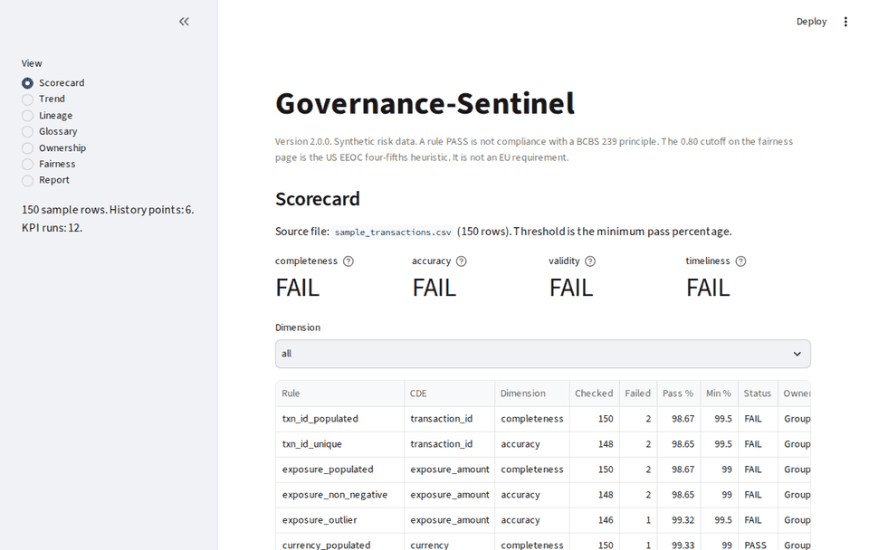
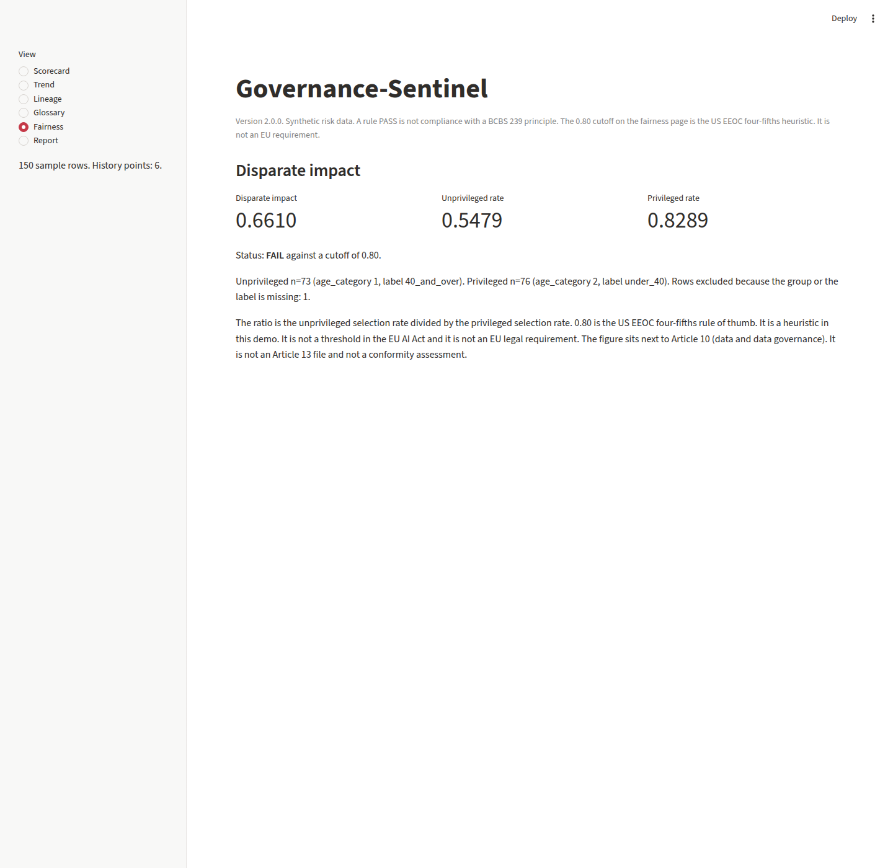
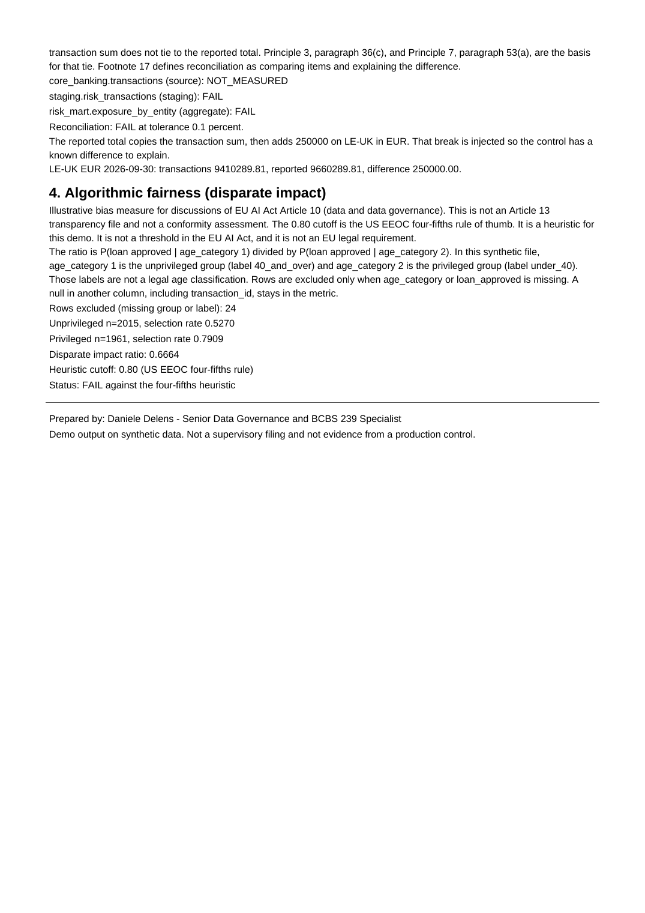
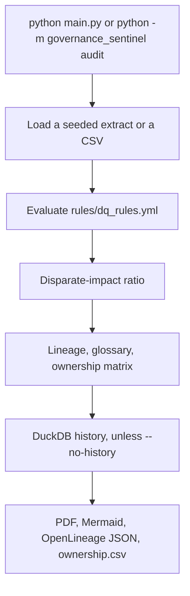
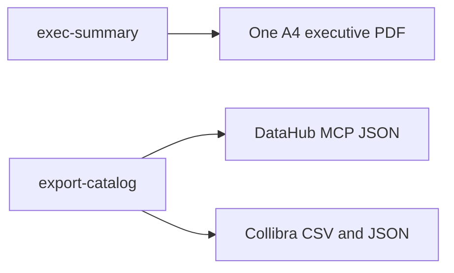
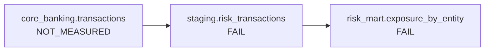
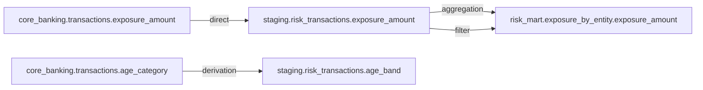
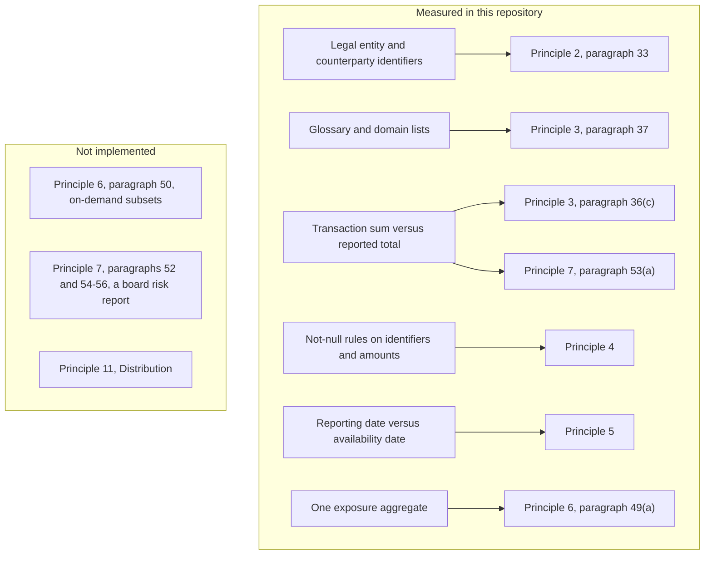
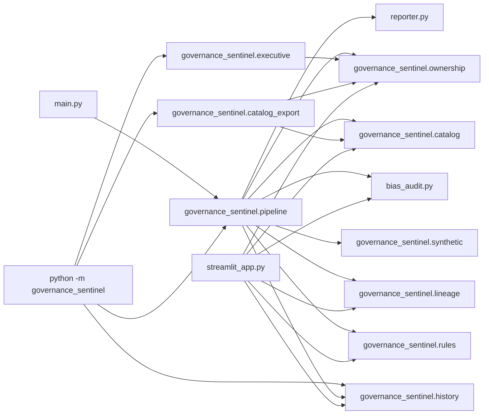
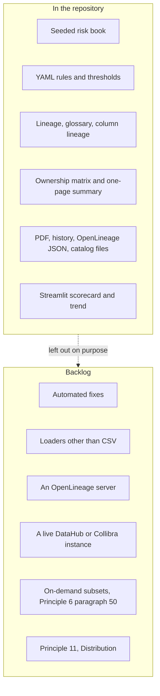

# Governance-Sentinel

[](https://github.com/delens/Governance-Sentinel/actions/workflows/ci.yml)
[](https://www.python.org/downloads/release/python-3120/)
[](LICENSE)



A compliance-as-code prototype for a data-governance review: declarative data-quality rules on a seeded book of risk transactions, mapped to BCBS 239, with a business glossary, an ownership matrix of roles, technical and column lineage, a transaction-to-aggregate reconciliation, a local history of principle scores, a one-page executive summary, file exports for DataHub and Collibra, a disparate-impact illustration, a full PDF, and a Streamlit scorecard.

**Notice.** Personal research sandbox. The data is synthetic. This project is not affiliated with any employer, client, or production system. The full notice is at the end of this file.

## Run it

Requires **Python 3.12**.

```bash
python -m pip install -r requirements.txt
python main.py
python -m governance_sentinel audit --input data/sample_transactions.csv --rules rules/dq_rules.yml --out Audit_Report.pdf
```

`python main.py` generates 4,000 rows (seed 239), audits them, and writes `Audit_Report.pdf`. The module command audits the committed 150-row sample. Both exit 0.

| Command | What it writes |
| --- | --- |
| `python main.py` | `data/generated_transactions.csv`, `Audit_Report.pdf`, `lineage.mmd`, `lineage.json`, `openlineage.json`, `column_lineage.json`, `column_lineage.csv`, `glossary.json`, `glossary.csv`, `ownership.csv`, `reconciliation.csv`, `history/governance_history.duckdb`, `governance_sentinel.log` |
| `python -m governance_sentinel exec-summary --input data/sample_transactions.csv --out Executive_Summary.pdf` | One A4 page: a red / amber / green light per scored principle (Principle 11 is not measured), the overall score, the delta versus the latest stored run when `history/governance_history.duckdb` already has runs, the top three open risks, the accountable role from the ownership matrix, and a due date for each action. It does not append a run. |
| `python -m governance_sentinel export-catalog --target datahub --out catalog_export` | `catalog_export/datahub_mcp.json`. Metadata Change Proposals for datasets, fields, glossary terms, ownership, and column lineage. No network call. |
| `python -m governance_sentinel export-catalog --target collibra --out catalog_export` | `catalog_export/collibra_assets.csv` and `catalog_export/collibra_import.json`. Business terms, data elements, role names, and the represents relation. No network call. |
| `python -m governance_sentinel generate --rows 4000 --seed 239 --out data/generated_transactions.csv` | A seeded extract and a copy of the counterparty master. No audit. |
| `python main.py --mode real --csv data/sample_transactions.csv` | Reads a CSV. It does not regenerate it. |
| `python -m governance_sentinel seed-history` | Twelve weekly runs in the DuckDB file. Defect scale and the reconciliation break change by week. The run ids and timestamps are fixed. |
| `python -m governance_sentinel history` | The stored runs, the principle-score matrix, and the latest delta. |
| `python main.py --no-history` | The same audit, without writing the database. |

`--history-db` changes the DuckDB path (default `history/governance_history.duckdb`). The database is gitignored. DuckDB is one local file and the history is a small analytical table, scores by principle over time, so the queries are SQL. SQLite would avoid a new dependency. DuckDB is pinned in `requirements.txt` and there is no server. `--log-level` sets the root logger (default `INFO`, or the `LOG_LEVEL` environment variable).

`runs/kpi_demo.json` is the same twelve-week series, committed so the dashboard can chart it before a local database exists. A non-empty database replaces that demo on the Trend page. A missing or empty DuckDB file, which is the case on Streamlit Community Cloud, leaves the demo series in place. The audit does not create that file when `--no-history` is set.

## Dashboard

The scorecard, the trend, the lineage graph, the glossary, the ownership matrix, the fairness result, the full PDF, and the one-page summary are in `streamlit_app.py`.

```bash
streamlit run streamlit_app.py
```

The app opens on the committed 150-row sample, the six-point history in `runs/history.jsonl`, and the twelve-week principle series in `runs/kpi_demo.json`. It does not need an API key. It does not need a local DuckDB file.

Live demo URL: coming soon.

Streamlit Community Cloud can run this repository from `main`:

- Main file path: `streamlit_app.py`
- Requirements file: `requirements.txt`
- Python version: 3.12 (`runtime.txt` and `.python-version`)
- `.streamlit/config.toml` turns usage stats off and leaves the port and address for Cloud to set

This repository does not deploy the app and does not create an account. The GIF above is a headless walkthrough of that app against the committed sample and the demo history. `scripts/record_dashboard_gif.py` records it with Playwright. Playwright is not a runtime dependency.




## Report




`Audit_Report.pdf` in the repository root is the output of `python main.py` (4,000 rows, seed 239). A later run overwrites it. The PDF carries the run id, the SHA-256 of the input file, the scorecard (rows checked, rows failed, pass percentage, minimum pass percentage, PASS or FAIL), remediation with sample failing ids, the ownership-matrix owner and steward for each failed rule, the reconciliation, and the fairness result. When the history database already holds an earlier run, the PDF adds a short trend against that run. The first run in an empty database does not.

`Executive_Summary.pdf` is a separate one-page file from `exec-summary`. It is not the multi-page audit. Red means the control failed. Amber means it passed and the score is under 99. Green means it passed and the score is at least 99. Principle 11 is marked not measured. The overall score can stay high while a principle is red. The top risks are a failed reconciliation, when there is one, then the field rules furthest under their threshold. The 250000 LE-UK EUR gap is injected, and the page says so. Due dates are 14, 21, and 30 days after the UTC date of the run. The accountable name on each risk is a role from `governance/ownership.yml`.

## Pipeline



A failed rule does not stop the run. A missing file, a missing column, an empty fairness group, or an ownership row that does not match the glossary does. `main` logs the traceback and exits 1.



`exec-summary` and `export-catalog` do not run the audit flow above. The catalog files are described in [docs/catalog-export.md](docs/catalog-export.md). They are not loaded into a DataHub or Collibra server.

## What a rule records

`threshold` in `rules/dq_rules.yml` is the minimum pass percentage. A rule PASSes when at least one record was checked and the pass percentage is at least that figure. The result stores rows checked, rows failed, the pass percentage, the threshold, PASS or FAIL, and up to five failing record ids. The full failing-id list stays on the result object for tests.

Validity is a data-quality dimension. It is not a BCBS 239 principle. Domain rules support Principle 3, paragraph 37, the dictionary of concepts.

| Rule | Dimension | What it checks | Principle it supports |
| --- | --- | --- | --- |
| `txn_id_populated` | Completeness | `transaction_id` is present | 4, paragraphs 41-43 |
| `txn_id_unique` | Accuracy | Non-missing identifiers are unique | 3, paragraph 36 |
| `exposure_populated` | Completeness | `exposure_amount` is present | 4 |
| `exposure_non_negative` | Accuracy | Non-missing amount is at least 0 | 3, paragraphs 36 and 40 |
| `exposure_outlier` | Accuracy | Interquartile-range screen on amounts at or above 0 | 3, paragraph 40 |
| `currency_populated`, `currency_domain` | Completeness, validity | Currency present and on the glossary list | 4 and 3, paragraph 37 |
| `rating_populated`, `rating_domain` | Completeness, validity | Rating present and on the scale. NR is a grade, not a blank | 4 and 3, paragraph 37 |
| `legal_entity_domain` | Validity | Group legal-entity identifier | 2, paragraph 33 |
| `product_domain` | Validity | Product family on the glossary list | 3, paragraph 37 |
| `counterparty_known` | Accuracy | Present on the counterparty master. A blank is a fail | 3, paragraph 36(c) and 36(d) |
| `availability_t_plus_1` | Timeliness | Business-day lag from `reporting_date` to `availability_date` is 0 or 1 | 5, paragraphs 44-47 |
| `reporting_date_populated` | Completeness | The as-of date is present | 5 |

The timeliness rule uses the numpy business-day calendar and the default weekmask. It has no holiday calendar. Principle 5 leaves the real deadline to the bank. T+1 is the worked example in this demo, not a supervisory SLA.

The outlier rule is an interquartile-range fence with k = 1.5. Values below 0 are left to the range rule. The fence is a screening heuristic, not a risk limit and not an accounting-materiality test. Paragraph 40 expects the bank to measure and monitor accuracy. This screen is a small version of that idea.

On the default 4,000-row file, eight rules fail and six pass. The failures are the injected defects sitting past their thresholds. The passes are the rules whose defect rate is inside the threshold.

The original four boolean checks remain in `validators.py` and are still unit-tested. The audit the CLI runs is the YAML engine.

## Synthetic book

`governance_sentinel/synthetic.py` builds the book. The default is 4,000 rows, seed 239, inside the 1,000 to 10,000 band. `data/sample_transactions.csv` is the first 150 rows of that same seed, committed so the dashboard and the module command have a file to open. `data/counterparties.csv` is the 40-row master. Fictional legal entities: Lumiere Banque SA, Nordhafen Bank AG, Thames Retail plc, Harbor National NA, Straits Markets Pte Ltd, Alpine Custody AG.

Defect counts are `round(rate * n)`. At 4,000 rows the rates below are exact. A row can carry more than one defect when the defects are on different columns. Within one column the defects do not overlap.

| Defect | Rate |
| --- | --- |
| Missing `transaction_id` | 1.0% |
| Duplicate `transaction_id` | 0.4% of rows overwritten, plus the donor row |
| Null exposure | 1.5% |
| Negative exposure | 1.0% |
| Exposure spike (500,000) | 0.8% |
| Invalid currency `XYZ` | 1.2% |
| Null currency | 0.4% |
| Orphan counterparty | 2.0% |
| Null counterparty | 0.5% |
| Availability more than T+1 | 3.0% |
| Unparseable availability date | 0.3% |
| Invalid rating `BAD` | 1.0% |
| Null rating | 0.8% |
| Null `age_category` | 0.4% |
| Null `loan_approved` | 0.2% |

Target approval rates, before those nulls: 0.78 for the privileged group and 0.54 for the unprivileged group. The expected disparate-impact ratio is about 0.69. The realised ratio depends on the seed. On seed 239 and 4,000 rows it is below 0.80. The 150-row sample is too small for that ratio to be stable. The history file uses 1,200 rows per point.

The reported exposure total copies the transaction sum and then adds 250,000 on LE-UK in EUR. That break is injected so the reconciliation has a difference to explain. The tolerance is 0.1 percent of the absolute transaction total. The 500,000 spikes are above the interquartile fence and small enough that 250,000 still exceeds the tolerance on the LE-UK EUR slice.

## Lineage and glossary



`docs/lineage.mmd` is that picture, generated from the metadata for the committed sample. A test checks that the file matches the generator. The source node is `NOT_MEASURED`: this prototype does not have a separate booking extract. Rules run on the staged CSV. The aggregate inherits a staging FAIL, and it also FAILs when the reconciliation FAILs. `networkx` builds the same directed graph for the dashboard.

Column flow, declared in `governance_sentinel/column_lineage.py` and drawn in [docs/column_lineage.mmd](docs/column_lineage.mmd):

- `direct`: a staged column copied from the booking extract, and the aggregate group keys `legal_entity_id`, `currency`, and `reporting_date`.
- `derivation`: `age_band` is the label of `age_category` (1 is `40_and_over`, 2 is `under_40`). It is produced at staging. The logical booking extract does not carry `age_band`.
- `aggregation`: the aggregate `exposure_amount` is the sum of the staged amount by legal entity, currency, and reporting date.
- `filter`: rows with a null `exposure_amount` are excluded before that sum.

The booking extract is not a second file. The source node is the declared origin of the staged CSV. Each edge records the glossary terms whose physical column is either end of the edge, so a term can be walked from the extract to the aggregate. Columns with no term, including `record_id` and the fairness fields, stay unlinked. `column_lineage.json` and `column_lineage.csv` are written next to the glossary export.



`openlineage.json` puts that mapping in the `columnLineage` dataset facet. A direct copy is OpenLineage type `DIRECT`. Aggregation, derivation, and filter are type `INDIRECT`, with the word kept in `subtype` and `description`. Inputs and outputs also carry a `schema` facet. The same event fills `dataQualityMetrics` (null count, count, distinct count, and sum/min/max on exposure) and `dataQualityAssertions` (one assertion per rule). It is still one COMPLETE document. It is not a Marquez client and it does not talk to a server.

The reconciliation supports:

- Principle 3, paragraph 36(c): risk data reconciled with the bank's sources. Footnote 17 defines reconciliation as comparing items and explaining the difference.
- Principle 7, paragraph 53(a): a defined tie from a reported total back to risk data. This is not a board risk report. Paragraphs 52 and 54-56 are not implemented.
- Principle 6, paragraph 49(a): one aggregate grain. Paragraph 50, an on-demand subset for a supervisory query, is not implemented.

Principle 2, footnote 16, is about automated reconciliation where more than one data model is in use. The check here is one transaction extract against one aggregate. That is the Principle 3 / Principle 7 case, not that footnote.

`catalog/glossary.yml` links each business term to a CDE, a physical column, the DQ rules, and an owner. A term that cites a missing rule or a missing column is rejected at load. Each run writes `glossary.json` and `glossary.csv`.

`governance/ownership.yml` is one row per glossary term: data owner, data steward, source system, criticality, tolerance, and the linked rules. The owner and the steward are roles. The tolerance is the lowest minimum pass percentage of those rules. Load fails when a glossary term has no row, a cited rule does not exist, or the tolerance does not match the rules. Each audit writes `ownership.csv`. The dashboard has the same table and a CSV download. The full PDF names that owner on every failed rule.

## Disparate impact

AIF360's `BinaryLabelDatasetMetric.disparate_impact` is:

$$DI = \frac{P(\text{loan approved} \mid \text{unprivileged})}{P(\text{loan approved} \mid \text{privileged})}$$

`age_category` 1 is the unprivileged group in this demo (label `40_and_over`). `age_category` 2 is the privileged group (label `under_40`). Those labels are synthetic. They are not a legal age classification.

The PDF and the dashboard treat a ratio below 0.80 as a fail against the US EEOC four-fifths rule of thumb. That figure is a heuristic here. It is not a threshold in the EU AI Act, and it is not an EU legal requirement. The metric sits next to Article 10 (data and data governance). It is not an Article 13 transparency file, and it is not a conformity assessment.

Rows are dropped only when `age_category` or `loan_approved` is missing. A null in any other column, including `transaction_id`, stays in the metric. If either group has no complete row, the audit raises instead of returning a silent NaN. If the privileged selection rate is zero, the ratio is undefined and the status is `UNDEFINED`.

TensorFlow is not installed or imported. AIF360's TensorFlow extra is only for adversarial debiasing, which this prototype does not run.

## BCBS 239

Principle numbers follow the Basel Committee on Banking Supervision, *Principles for effective risk data aggregation and risk reporting* (BCBS 239), January 2013: <https://www.bis.org/publ/bcbs239.pdf>.

A pass on a rule is the field check. It is narrower than the principle it supports.

| Principle | Paragraphs used here | What this prototype actually does |
| --- | --- | --- |
| 2 Data architecture and IT infrastructure | 33, and 34 for named owners | Glossary, single identifiers for legal entity and counterparty, owner and steward on every rule |
| 3 Accuracy and Integrity | 36, including 36(c) and 36(d), 37, 40 | Range, uniqueness, referential check, dictionary lists, IQR screen, reconciliation to the transaction sum |
| 4 Completeness | 41-43 | Not-null rules, and a legal-entity identifier so the book can be cut by entity |
| 5 Timeliness | 44-47 | Business-day lag from reporting date to availability date. The deadline is the demo's, not the Committee's |
| 6 Adaptability | 49(a) only | One aggregate grain. Not paragraph 50 |
| 7 Accuracy | 53(a) and the idea of 53(b) | The tie-out, and the rule inventory as a validation list. Not a board report |
| 11 Distribution | 72-73 | Not implemented. The history store records it as not measured |

The history store scores principles 2, 3, 4, and 5 as the mean pass percentage of the rules that cite them. A high mean can sit next to a failed rule, and the status follows the failed rule. Principle 6 is stored as 100 because the one grain exists. Paragraph 50 is not in that score, so it does not move when the data changes. Principle 7 is the share of reconciliation slices inside the 0.1 percent tolerance. One failed slice still fails the reconciliation. Principle 11 has no score. The overall score is the unweighted mean of principles 2, 3, 4, 5, 6, and 7. None of these figures is a finding that the principle is met.



## Modules



`validators.py` and `data_loader.py` still hold the original five-row field checks. `python main.py` does not call them. Column lists and the stops are in [docs/architecture.md](docs/architecture.md).

## Roadmap

Shipped: the seeded book and its defect manifest, the YAML rules including referential, T+1, and the IQR screen, the PDF scorecard, the one-page executive summary, the glossary, the ownership matrix, dataset and column lineage, the reconciliation, one OpenLineage COMPLETE event with schema and columnLineage facets, DataHub and Collibra files, a DuckDB history of principle scores, the disparate-impact audit, the CLI, and the Streamlit app.

Still out, on purpose: automated fixes, a loader other than CSV, a running OpenLineage or Marquez server, a live DataHub or Collibra instance, an on-demand aggregate for a supervisory query (Principle 6, paragraph 50), the rest of Principle 7 beyond the tie-out, and distribution controls (Principle 11). The one-page summary is not that board risk report.



## Checks

```bash
python -m pip install -r requirements-dev.txt
ruff check .
ruff format --check .
mypy
pytest
```

GitHub Actions runs those commands on Python 3.12 (`.github/workflows/ci.yml`).

## Changelog

The version in the code is 2.0.0. The history is in [CHANGELOG.md](CHANGELOG.md). No git tag has been created for it.

Notes ready for a GitHub release are in [docs/release-notes-v2.0.0.md](docs/release-notes-v2.0.0.md). This repository does not publish that release.

## License

MIT. See [LICENSE](LICENSE).

## Full notice

**This repository is a personal sandbox environment, developed entirely in my own time and on my own initiative.**

The project was created to explore open-source tooling — Python, draw.io, Mermaid, AI libraries — applied to regulatory scenarios inspired by publicly available frameworks such as BCBS 239 and the EU AI Act. Its purpose is strictly educational and experimental.

> **All data used in this project is entirely synthetic and artificially generated.** It does not contain, reproduce, or derive from any real data, systems, internal processes, documentation, or intellectual property belonging to any organisation. Any resemblance to real business scenarios is purely coincidental and a natural consequence of working with publicly documented regulatory frameworks.

This project is not connected in any way to any professional activity, employer (past or present), client, or production system. No proprietary code, data, process, or business know-how has been used, reproduced, or exported.
