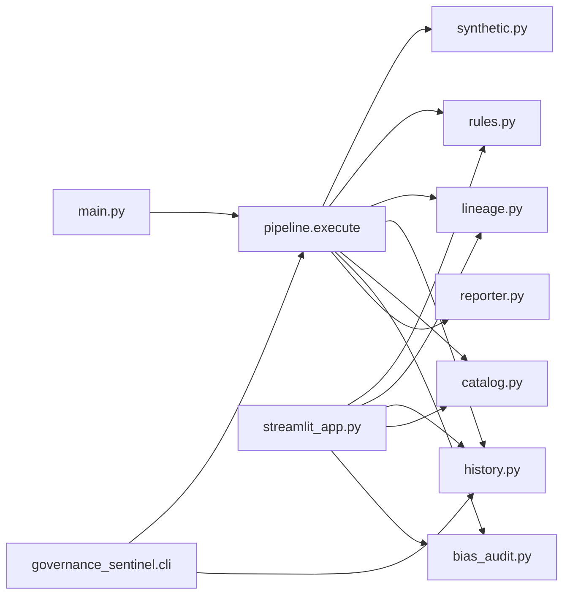
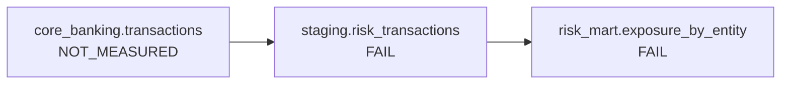

# Architecture

Module map for the code in this repository. The pipeline diagram and the roadmap are in the [README](../README.md).

`python main.py` and `python -m governance_sentinel audit` both call `governance_sentinel.pipeline.execute`. The Streamlit entry point is `streamlit_app.py`. It loads the committed sample through `governance_sentinel.dashboard_data` and does not start the command-line pipeline.

| Module | Role |
| --- | --- |
| `main.py` | `python main.py`. Logging, then the pipeline. |
| `governance_sentinel/cli.py` | `audit`, `generate`, `history`, and `seed-history`. |
| `governance_sentinel/pipeline.py` | Load, rules, fairness, lineage, glossary export, history, PDF. |
| `governance_sentinel/synthetic.py` | Seeded extract and the counterparty master. An optional defect-rate map changes the injection. |
| `governance_sentinel/rules.py` | Load `rules/dq_rules.yml` and evaluate it. |
| `governance_sentinel/lineage.py` | Aggregate, reconciliation, status propagation, Mermaid, networkx, OpenLineage event. |
| `governance_sentinel/column_lineage.py` | Column edges (direct, aggregation, derivation, filter), glossary trace, schema and columnLineage facets. |
| `governance_sentinel/history.py` | DuckDB run store, principle scores, and the twelve-week seed. |
| `governance_sentinel/scores.py` | How each principle score is defined. |
| `governance_sentinel/catalog.py` | Glossary load and JSON/CSV export. |
| `bias_audit.py` | Disparate-impact ratio through AIF360. |
| `reporter.py` | PDF. `FRAMEWORK_VERSION` is the package version, 2.0.0. |
| `validators.py` | Original four boolean field checks. Not called by the pipeline. |
| `data_loader.py` | Original five-row mock file. Not called by the pipeline. |
| `streamlit_app.py` | Dashboard. Community Cloud entry file. |

`bias_audit.py` is imported inside the pipeline and inside the dashboard loader, after the optional-extra log filter is installed. TensorFlow is not a dependency.

## Columns

| Set | Columns | Used by |
| --- | --- | --- |
| `TRANSACTION_COLUMNS` | `record_id`, `transaction_id`, `legal_entity_id`, `legal_entity_name`, `source_system`, `counterparty_id`, `product_type`, `currency`, `exposure_amount`, `internal_rating`, `reporting_date`, `availability_date`, `age_category`, `age_band`, `loan_approved` | The seeded extract and `--mode real` |
| Fairness columns | `age_category`, `loan_approved` | The disparate-impact ratio |
| Aggregate grain | `legal_entity_id`, `currency`, `reporting_date`, sum of `exposure_amount` | The reconciliation |
| `REQUIRED_COLUMNS` in `data_loader.py` | The original seven fields | The five-row mock only |

`record_id` is always populated. Failing-id samples use it, including when `transaction_id` is null.

## Where a run stops

| Step | Raises | Still continues |
| --- | --- | --- |
| Load | Real mode: file missing, or a transaction column missing. Mock mode: `n` outside 30 to 20,000. | A failed rule does not stop the run. |
| Rules | Unknown rule type, a principle title that does not match the 2013 text, a missing column, a missing reference file. | An empty frame fails every rule and continues. |
| Fairness | `age_category` or `loan_approved` is absent, no complete row, or either demo group is empty. | A null in another column does not drop the row. A zero privileged selection rate returns status `UNDEFINED`. |
| Lineage | The injected break has no LE-UK EUR slice to land on. | A failed reconciliation is a result, not an exception. |
| Glossary | A term cites a rule, column, dataset, or principle that does not resolve. | |
| History | The DuckDB file cannot be written. | `--no-history` skips the write. A missing previous run omits the PDF trend section. |
| PDF | An exception from writing the file. | |
| `main` | Logs the traceback and exits 1 when a step raises. | The default file exits 0. |

## Lineage

The picture below is the committed sample. Staging is FAIL because rules fail. The aggregate is FAIL because staging is FAIL and because the LE-UK EUR reported total is 250,000 over the transaction sum. The source is NOT_MEASURED.

The same text is in [lineage.mmd](lineage.mmd). `tests/test_dashboard.py` regenerates it from the sample and compares the file.

Column edges are in [column_lineage.mmd](column_lineage.mmd). `age_band` is derived at staging from `age_category`. The aggregate sum drops null exposure amounts. A test compares the file with the generator. The logical booking extract does not include `age_band`. The staged CSV does.

## History

Each audit writes `history/governance_history.duckdb` unless `--no-history` is set. The file is gitignored. `runs/kpi_demo.json` is the committed twelve-week series the dashboard uses when the database is absent or empty. `runs/history.jsonl` is the older six-point series. Its defect rates do not change, so the dimension pass rates are flat.

## Principles

The numbers follow BCBS 239 (Basel Committee, January 2013). The mapping table and the limit of each citation are in the [README](../README.md#bcbs-239).

`validators.py` still maps the original four field checks: completeness to Principle 4, the amount range and the currency list to Principle 3, timeliness to Principle 5. Validity remains a data-quality dimension under Principle 3. Those four functions are the regression tests for that first design. They are not the audit the CLI runs.

## Backlog

The [roadmap](../README.md#roadmap) lists what is still out: automated fixes, a loader other than CSV, an OpenLineage server, on-demand subsets under Principle 6 paragraph 50, and Principle 11. Principle 11 is stored in the history as not measured.
