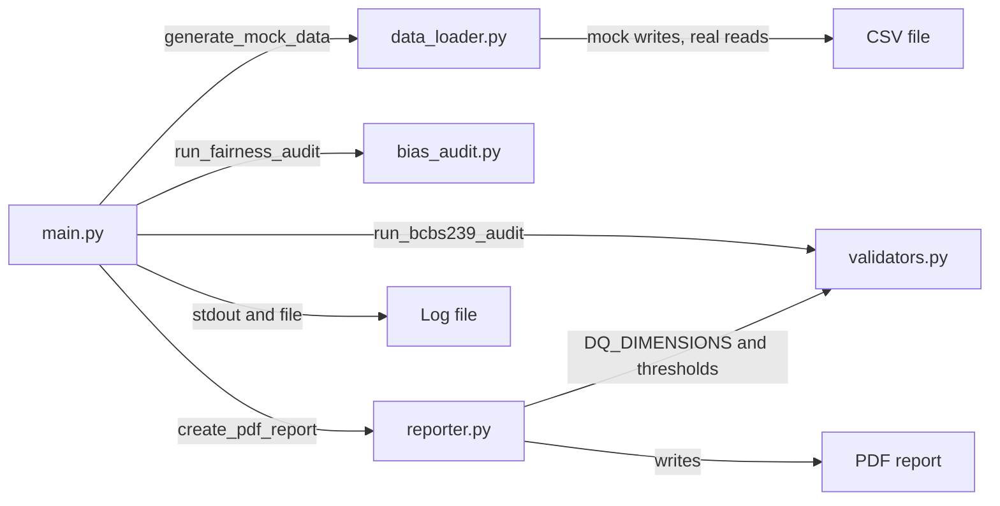
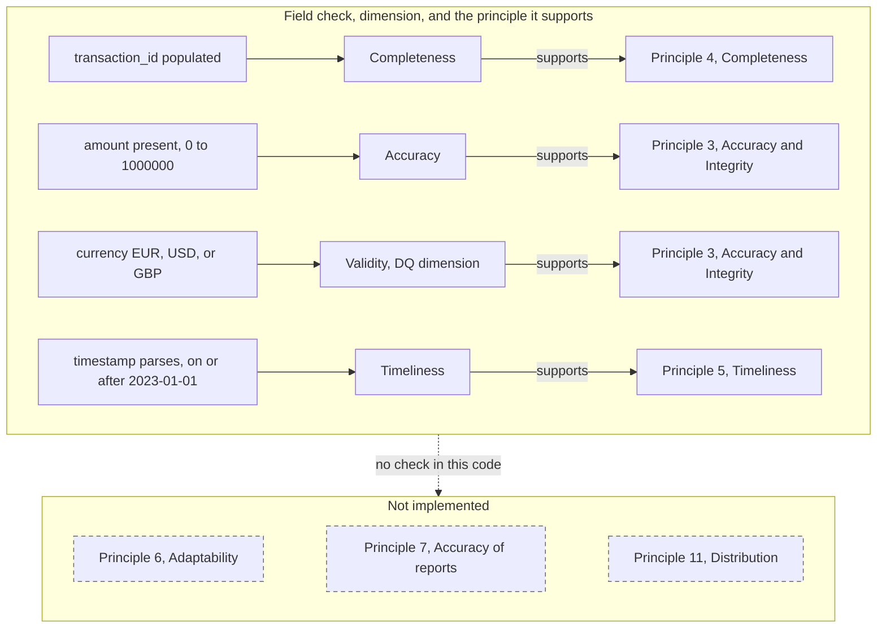

# Architecture

Module map for the code in this repository. The pipeline diagram and the roadmap diagram are in the [README](../README.md#pipeline).

`main.py` is the orchestrator. The other modules do not call each other, except `reporter.py`, which reads the principle map and the check thresholds from `validators.py`.

| Module | Call from `main` | Result |
| --- | --- | --- |
| `main.py` | `main` | Four steps. Logs to stdout and the log file. |
| `data_loader.py` | `generate_mock_data` | A DataFrame. Mock mode also writes the CSV. |
| `validators.py` | `run_bcbs239_audit` | Four booleans: Completeness, Accuracy, Validity, Timeliness. |
| `bias_audit.py` | `run_fairness_audit` | One float, from AIF360 `BinaryLabelDatasetMetric.disparate_impact`. |
| `reporter.py` | `create_pdf_report` | Writes the PDF. `FRAMEWORK_VERSION` is `1.2.0`. |

`bias_audit.py` is imported inside `main`, after `configure_logging`. The root log level is `--log-level` or `LOG_LEVEL`, default `INFO`. TensorFlow is not a dependency.

## Columns

| Set | Columns | Used by |
| --- | --- | --- |
| `REQUIRED_COLUMNS` | `transaction_id`, `client_id`, `amount`, `currency`, `timestamp`, `age_category`, `loan_approved` | Real-mode CSV |
| `REQUIRED_AUDIT_COLUMNS` | `transaction_id`, `amount`, `currency`, `timestamp` | The four data-quality checks |
| Fairness columns | `age_category`, `loan_approved` | The disparate-impact ratio |

In the synthetic file, `age_category` 1 is the unprivileged group and `age_category` 2 is the privileged group. `loan_approved` is the label. Rows missing either fairness column are dropped from the ratio. A null `transaction_id` stays in the ratio.

## Where a run stops

| Step | Raises | Still continues |
| --- | --- | --- |
| `generate_mock_data` | Real mode: file missing, or a `REQUIRED_COLUMNS` entry missing. Any mode other than `mock` or `real`. | Mock mode writes five rows and returns them. |
| `run_bcbs239_audit` | `transaction_id`, `amount`, `currency`, or `timestamp` is absent. | An empty frame returns fail for all four checks. The caller's frame is copied and left unchanged. |
| `run_fairness_audit` | `age_category` or `loan_approved` is absent, or no row keeps both. | A null in another column, including `transaction_id`, does not drop the row. |
| `create_pdf_report` | An exception from writing the PDF. | An unmapped dimension is logged and still printed. A disparate-impact ratio under 0.80 is a fail line on the PDF. |
| `main` | Logs the traceback and exits 1 when one of the steps raises. | A failed check does not stop the run. The sample file exits 0. |

The command line only accepts `--mode mock` and `--mode real`. A bad flag exits through the argument parser.

## Principles

The numbers follow BCBS 239 (Basel Committee, January 2013). A pass on one field is the field check. It is narrower than the principle it supports. The same diagram is in the [README](../README.md#bcbs-239-mapping), next to the paragraph references.

Validity is a data-quality dimension under Principle 3. Principle 7 is the reporting principle, separate from Principle 3. The lower group matches `validators.NOT_IMPLEMENTED`.

## Backlog

The [roadmap](../README.md#roadmap) lists what is in the repository and what is left out on purpose. The backlog is a dashboard, data lineage, a rules catalog, automated fixes, and loaders other than CSV. Data lineage and the rules catalog are backlog items.
